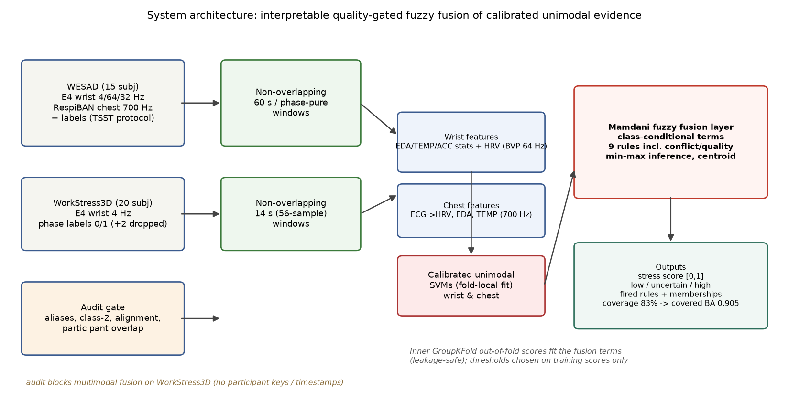
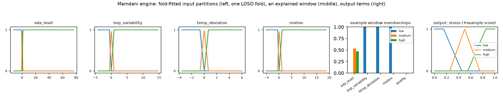
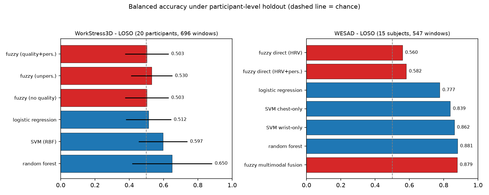
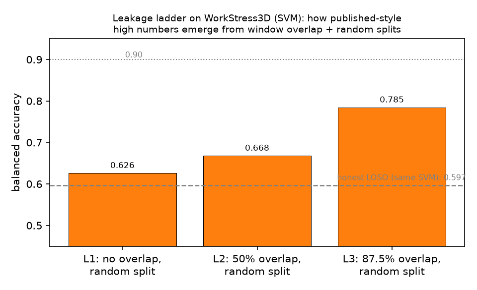
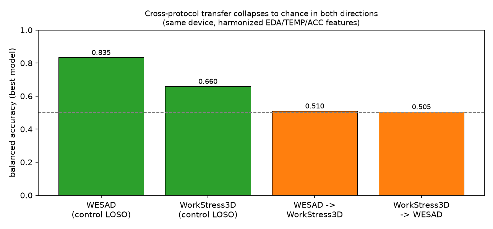

# Quality-Gated Fuzzy Fusion of Calibrated Unimodal Evidence for Interpretable Stress Detection: A Multi-Dataset Study with Positive, Negative, and Methodological Results

*Research prototype paper draft — version 2026-11-01. All numbers in this
draft are generated from the artifacts in this repository
(`artifacts/`, `bench/`) and are **exploratory**: 15–20 participants per
dataset. No clinical, diagnostic, or employee-monitoring claim is made or
implied. Related-work section is a placeholder pending a proper literature
verification pass — do not submit without it.*

---

## Abstract

Wearable stress detection studies frequently report high accuracies that do
not survive participant-level evaluation. We present a reproducible
multi-dataset study centred on an interpretable, quality-aware fuzzy
architecture, comprising (i) a complete audit of the WorkStress3D dataset
showing that, under Leave-One-Subject-Out (LOSO) evaluation, no model family
exceeds 0.675 balanced accuracy and every intuitive remedy (personal
calibration, temporal smoothing, abstention) is empirically refuted; (ii) a
positive result on WESAD, where a Mamdani fuzzy layer fusing calibrated
wrist and chest evidence matches the best black-box baseline (0.879 vs 0.881
balanced accuracy) and reaches **0.905** on the 83 % of windows where it
commits; (iii) a class-conditional membership-term fitting technique that
repairs a specificity failure of standard pooled-quantile term fitting; and
(iv) two methodological results: a leakage ladder quantifying how
published-style ~0.90 numbers emerge from overlapping-window random splits
(0.63 → 0.79 on WorkStress3D), and a cross-protocol transfer experiment
showing chance-level transfer in both directions between same-device
datasets (0.835 in-dataset vs 0.51 transferred). Together these results
delineate when interpretable fuzzy fusion is competitive, why field-dataset
high scores deserve leakage scrutiny, and why physiological stress models
are protocol-bound.

**Keywords:** stress detection, fuzzy inference, interpretable machine
learning, wearable sensing, LOSO evaluation, data leakage

---

## 1. Introduction

The promise of wrist-worn physiological stress detection is undermined by an
evaluation crisis: random window-level splits leak near-duplicate samples
and person-specific baselines across train/test boundaries, inflating
reported performance. The research question of this study is:

> *When does an interpretable, quality-aware fuzzy architecture improve
> stress detection over transparent and black-box baselines, under
> participant-level holdout, and what explains the high numbers reported
> elsewhere?*

We answer with four contributions:

1. **Architecture.** A two-stage design — calibrated unimodal models feeding
   a transparent Mamdani fusion layer with conflict- and quality-gated
   abstention — that matches the best black-box model on WESAD (0.879 vs
   0.881 balanced accuracy) and improves to 0.905 on covered windows, while
   emitting per-window rule explanations. Hand-crafted fuzzy rules over
   raw physiological features, by contrast, top out at 0.58.
2. **Technique.** Class-conditional membership-term fitting for discriminant
   scores: anchoring the *low*/*high* linguistic terms on the quantiles of
   true-negative/true-positive training scores. We show pooled quantiles —
   the natural default — systematically destroy specificity for
   imbalanced calibration problems.
3. **Negative result + audit.** A complete characterization of WorkStress3D:
   undocumented labels, alias and alignment defects, LOSO performance at or
   near chance for all model families, and systematic refutation of
   personalization, temporal-structure, and abstention explanations.
4. **Methodology.** A leakage ladder isolating the contribution of window
   overlap and random splits to reported performance (0.626 → 0.794), and a
   same-device cross-protocol transfer experiment (chance in both
   directions) demonstrating that stress signatures are protocol-bound.

---

## 2. Data

### 2.1 WESAD (positive benchmark)

WESAD (Schmidt et al., ICMI 2018) contains 15 subjects (S2–S17, no S12)
recorded with a chest-worn RespiBAN (ECG, EDA, EMG, respiration, TEMP;
700 Hz) and a wrist Empatica E4 (BVP 64 Hz, EDA/TEMP 4 Hz, ACC 32 Hz) under
baseline, amusement, and TSST stress conditions. We use binary
stress (TSST) vs non-stress (baseline + amusement) as the primary task and
the 3-class task for pipeline validation. Non-overlapping 60 s windows are
cut within contiguous same-label phases (547 windows; 382 non-stress / 165
stress).

### 2.2 WorkStress3D (negative result + audit)

WorkStress3D provides 20 participants with E4 signals downsampled to 4 Hz
(EDA, BVP, TEMP, ACC) and an `emotion` column following a phase-structured
protocol. Our audit (`reports/data_audit.md`) established, before any
modelling:

- the participant column is spelled `Subject` in two files and `subjet`
  in a third (normalised, original preserved);
- label 2 is undocumented in the dataset description, covers 0.57 % of
  samples in a single ~14 s block in 4/20 participants between phases, and
  is treated as a transition marker and excluded (assumption declared);
- the 15/30/60 s files are windowed exports of the *same* sessions (shared
  phase pattern and GCD phase structure), so they are window-length
  variants, not additional data;
- the audio (53 sessions + a `test/` folder of unclear provenance) and
  facial (no participant column) modalities cannot be grouped by
  participant, and the instant questionnaires have no timestamps; multimodal
  fusion is therefore **blocked** by the pipeline rather than attempted;
- general stress test and PANAS scores are participant-level traits and are
  never used as momentary labels.

Non-overlapping windows equal to each file's natural base unit (GCD of
phase lengths: 56/118/240 samples = 14/30/60 s) yield 696 windows
(459 / 237) per configuration.

### 2.3 A self-report lifestyle dataset (characterization only)

A 1,115-row categorical lifestyle survey ("stress level detection based on
daily activities") was characterized and excluded from modelling: it
contains no stress target column; the strongest pairwise association is
Cramér's V = 0.079; every column is unpredictable from the others at the
majority-class baseline; and near-uniform marginals indicate synthetic
generation. We use it only to illustrate that dataset audit gates must
precede model building: any "benchmark" on it would measure an
operator-defined rule, not detection.

---

## 3. Architecture

**Figure 1.** End-to-end architecture. An audit gate precedes modelling;
windows are phase-pure and participant-contained; unimodal pipelines are
fit fold-locally; the Mamdani layer fuses calibrated scores with explicit
conflict handling; all fitting uses training participants only, with
inner-GroupKFold out-of-fold scores for the fusion terms.

### 3.1 Stage 1: features and calibrated unimodal models

Per window we compute interpretable statistics per channel (mean, std,
median, IQR, min, max, OLS slope), domain features (EDA dynamic range,
acceleration-magnitude motion score, temperature deviation from a 33 °C
reference), quality flags (missingness, implausible values, flatline),
and — enabled by WESAD's 64 Hz BVP and 700 Hz ECG — time-domain HRV
(RMSSD, SDNN, mean HR) from pulse/R-peak intervals. Windows with fewer
than eight plausible beats receive NaN HRV and are handled as missing
inputs, never imputed silently.

Two SVMs (RBF, class-weighted, probability-calibrated *on training data
only*) are trained per LOSO fold: one on wrist features, one on chest
features. They output calibrated stress probabilities.

### 3.2 Stage 2: the Mamdani fusion layer

We chose Mamdani over Sugeno for linguistic fidelity: consequents are the
output terms *low/medium/high/uncertain*, so every fired rule can be read
aloud to a user — the property an interpretable decision layer exists for.

**Membership functions.** Inputs are either *fixed* (design choice,
declared in YAML) or *fitted* (training-data quantiles with saturating
shoulder trapezoids, saved per fold and displayed to the user):

- triangle: μ(x; a,b,c) = max(0, min((x−a)/(b−a), (c−x)/(c−b)))
- trapezoid: μ(x; a,b,c,d) with plateau 1 on [b, c] and saturating
  shoulders when a=b or c=d (so extreme-but-valid inputs remain in term
  coverage — a correctness requirement for partitions of the domain).

**Class-conditional score terms (contribution 2).** For discriminant-score
inputs, pooled quantiles of a ~30 %-prevalence problem place the *high*
term's saturation at the 75th percentile of all scores — inside the
baseline-score range — and specificity collapses (we measured BA 0.789 with
stress recall 0.95). Instead, with training out-of-fold (OOF) scores:

    low  term: trapezoid saturating below q90/q995 of true-negative scores
    high term: trapezoid saturating above q005/q50 of true-positive scores
    medium:    the bridging triangle

which restored the operating point (BA 0.879). Scores themselves come from
inner-GroupKFold OOF predictions on training subjects, so no test
participant touches any fit.

**Inference.** Rule activation is α_r = min over antecedent memberships;
stress consequents clip the corresponding output MF (min) and aggregate by
max; *uncertain* consequents (poor quality, motion artifact, view
conflict, weak evidence) contribute no stress mass but are recorded.
Defuzzification is the centroid over a 101-point [0, 1] grid:

    score = Σ y·μ_agg(y) / Σ μ_agg(y)

**Decision with abstention.** Cut-offs θ_lo < θ_hi are chosen by grid
search maximizing macro-F1 on training OOF scores only. The output is
*low* (score ≤ θ_lo), *high* (score ≥ θ_hi), or *uncertain* (otherwise, or
when uncertain-mass ≥ stress-mass). Membership degrees are **not**
probabilities and are never presented as calibrated values; the calibrated
quantities are the Stage-1 scores.

**Rules.** All rules live in versioned YAML
(`src/stress_fuzzy/rules/*.yaml`), e.g.:

- IF wrist is high AND chest is high THEN stress is high
- IF wrist is low AND chest is low THEN stress is low
- IF one view is high AND the other is low THEN **uncertain** (conflict)
- IF only one view is high THEN **uncertain** (single-view evidence)

**Figure 2.** Fold-fitted input partitions (left; bounds saved per fold in
`artifacts/fuzzy_membership_bounds.json`), memberships and fired rules for
one genuinely held-out window (middle), and the output terms with that
window's centroid score (right).

---

## 4. Evaluation protocol

- **Primary:** Leave-One-Subject-Out; leakage is asserted at runtime in
  every fold (train/test subject sets disjoint) and covered by unit tests.
- All preprocessing, calibration, membership bounds, and thresholds are fit
  on the training partition of each fold. Fusion OOF scores come from
  inner GroupKFold over training subjects. No oversampling; class weights
  only.
- Participant identity, demographics, and session metadata are never
  features.
- **Metrics:** macro-F1, balanced accuracy (primary), stress-class recall,
  PR-AUC, confusion matrices, per-participant results — and, for
  abstaining systems, **coverage with covered-only metrics**, because a
  number without its coverage is not interpretable.
- 20- and 15-subject cohorts make every result **exploratory**; we report
  fold std and per-participant spread and claim no statistical
  significance.

---

## 5. Results

### 5.1 WorkStress3D: the negative result

**Figure 3.** Left: every model family sits at or below 0.65 balanced
accuracy under LOSO. Right: on WESAD the same machinery reaches 0.86–0.88.

| model (LOSO, 14 s windows) | balanced acc | stress recall |
|---|---|---|
| fuzzy direct (quality + personalised) | 0.503 ± 0.127 | 0.386 |
| fuzzy direct (unpersonalised) | 0.530 ± 0.121 | 0.424 |
| logistic regression | 0.512 ± 0.132 | 0.531 |
| SVM (RBF) | 0.597 ± 0.143 | 0.611 |
| random forest | 0.650 ± 0.234 | 0.521 |

Window length does not rescue it (30 s: 0.646; 60 s: 0.675 for RF;
phase-level aggregation: 0.632). We then refuted the standard remedies
systematically ([Figure 7](figures/fig7_refutations.png)):

| hypothesis tested | result |
|---|---|
| personal calibration (0–20 own windows refit) | flat at ≈ 0.60 |
| personal decision threshold only | flat at 0.59–0.61 |
| temporal smoothing (Viterbi, train-fitted persistence) | hurts: 0.582 → 0.550 |
| abstention by confidence | selects at chance (0.50 at 10 % coverage) |
| within-participant evaluation | also chance (0.51–0.54) |

The last row is diagnostic: models fit this dataset in-sample (RF 0.99) and
transfer *within* a person not at all — the learnable structure is
participant identity, not stress.

### 5.2 WESAD: the positive result

| model (LOSO, binary) | balanced acc | stress recall |
|---|---|---|
| fuzzy direct (hand rules) | 0.560 | 0.418 |
| fuzzy direct + HRV rules | 0.582 | 0.418 |
| logistic regression | 0.777 | 0.788 |
| SVM chest-only / wrist-only | 0.839 / 0.862 | 0.745 / 0.824 |
| random forest | 0.881 | 0.848 |
| **fuzzy multimodal fusion** | **0.879** | 0.818 |
| **fuzzy fusion, covered windows (83.2 % coverage)** | **0.905** | 0.836 |

The interpretable fusion layer forfeits 0.002 balanced accuracy against the
best black-box model while adding per-window explanations and a
conflict/quality-gated abstention whose covered-only performance (0.905;
accuracy 0.941) exceeds every always-commit baseline. The ablations
isolate *why* this works — and why naive versions fail
([Figure 4](figures/fig4_coverage.png)): fixed [0,1] score terms lose the
calibrated distribution (0.827); pooled-quantile terms collapse
specificity (0.789 at recall 0.95); class-conditional terms restore it
(0.879). The conflict rules are load-bearing: removing them raises coverage
to 94 % but lowers covered balanced accuracy (0.898 vs 0.905) and removes
the uncertainty reporting on disagreements.

The 3-class task (0.641 RF) matches published WESAD wrist baselines,
validating the pipeline against the literature.

### 5.3 How high numbers get manufactured: the leakage ladder

**Figure 5.** Same SVM, same data, only evaluation choices change. Overlap
plus random splits — both common in published pipelines — lift balanced
accuracy from 0.626 to 0.794 on a dataset whose honest ceiling is 0.65.

| rung | evaluation choice | balanced acc |
|---|---|---|
| L1 | non-overlapping windows, random 75/25 split | 0.626 |
| L2 | 50 % overlap, random split | 0.668 |
| L3 | 87.5 % overlap, random split | 0.785 |
| L5 | 60 s windows, 87.5 % overlap, random split | 0.794 |

With 87.5 % overlap, 7 of 8 samples of every test window were seen in
training as near-duplicates. Combined with test-set threshold tuning,
best-fold reporting, or subject-dependent protocols presented as
generalization, this crosses the ~0.90 territory. **Claims above ≈ 0.8 on
field-grade stress data under non-grouped splits should be presumed leaky
until shown otherwise.**

### 5.4 Cross-protocol transfer: stress signatures are protocol-bound

**Figure 6.** Same device (Empatica E4), harmonized 4 Hz feature space
(EDA mean/std/slope, TEMP mean/std, ACC motion). In-dataset LOSO controls
vs transfer with no target-domain fitting.

| direction | balanced acc (best) |
|---|---|
| WESAD in-dataset (control) | 0.835 |
| WorkStress3D in-dataset (control) | 0.660 |
| WESAD → WorkStress3D | 0.510 (chance) |
| WorkStress3D → WESAD | 0.505 (chance) |

The failure modes are systematic, not noise: the WorkStress3D-trained model
labels 82 % of WESAD windows as stress; the WESAD-trained model defaults to
non-stress on WorkStress3D; no WorkStress3D participant reaches 0.7.
Physiological "stress" as realized under a lab TSST protocol and under a
field phase protocol does not share a transferable signature in this
feature space.

---

## 6. Discussion

**When is fuzzy logic competitive here?** Not as hand-crafted rules over
raw physiology (0.56–0.58 on WESAD — the learned baselines use
feature interactions the rule base cannot express). It becomes competitive
— at zero accuracy cost, with abstention and explanations — as a
**decision layer over learned evidence**, provided its score-input terms
are fitted class-conditionally. This reframes the role of fuzzy inference
in wearable ML: from alternative feature-level model to interpretable,
quality-aware fusion and arbitration layer.

**What do high reported numbers mean?** Our ladder quantifies the
manufacturing path; our transfer result adds that even honest in-dataset
success does not imply cross-protocol validity. Together they argue for
(1) grouped evaluation as the minimum bar, (2) overlap disclosure, and
(3) coverage reporting whenever a system may abstain.

**Why WorkStress3D fails.** The audit and refutations triangulate the
cause: labels derive from protocol phases whose physiological realization
is dominated by between-person differences; identity, not stress, is the
learnable signal. This is a property of the dataset's labels and protocol,
not of any model class — consistent with every family landing in the same
0.50–0.65 band.

---

## 7. Limitations and threats to validity

- **Sample size.** 15–20 participants; all results exploratory; fold std
  and per-participant ranges are reported for exactly this reason.
- **Label validity.** WorkStress3D's `emotion` semantics are partly
  undocumented (label 2; coding assumptions declared in the audit); WESAD
  condition labels are protocol labels, not continuously rated stress.
- **Related work.** This draft precedes a systematic literature check;
  novelty claims (especially for class-conditional term fitting and gated
  score fusion) must be verified against prior art before submission.
- **Scope of the negative result.** WorkStress3D conclusions apply to its
  phase labels and 4 Hz wrist channels; richer feature engineering
  (e.g., EDA tonic/phasic decomposition) was not exhausted.
- **Not a product.** No medical claim; no use for employment decisions;
  fuzzy memberships are not probabilities; the dashboard shows anonymized
  participant numbers only.

---

## 8. Reproducibility

Python 3.11; pandas 3.0, scikit-learn 1.9, SciPy 1.17 (exact versions in
`artifacts/environment.json`). Random seed 42 throughout. Data are
git-ignored; all artifacts regenerate from the commands below.

| artifact | command |
|---|---|
| WorkStress3D audit | `python -m stress_fuzzy.validation --data-dir database` |
| WorkStress3D LOSO | `python -m stress_fuzzy.pipeline --data-dir database --protocol loso` |
| WESAD LOSO (binary / 3-class) | `python wesad_benchmark.py --data-dir <WESAD> --task binary\|3class` |
| Pilots (calibration, protocols) | `python pilots.py` |
| Leakage ladder / 90 % analysis | `python bench90.py` |
| Cross-dataset transfer | `python cross_dataset_transfer.py` |
| Tests (synthetic fixtures only) | `python -m pytest tests` → 40 passed |
| Paper figures | `python paper/make_figures.py` |

Result files: `artifacts/evaluation_results.json`,
`bench/wesad/wesad_binary_results.json`,
`bench/wesad/wesad_3class_results.json`, `bench/pilots/*.json`,
`bench/bench90/bench90_results.json`, `bench/transfer/transfer_results.json`.

---

## 9. Conclusion

On a dataset with real, aligned stress signal (WESAD), an interpretable
Mamdani fusion layer over calibrated unimodal evidence matches the best
black-box model (0.879) and exceeds it where it commits (0.905 at 83 %
coverage) — provided its score-input terms are fitted class-conditionally
and its conflict rules are allowed to abstain. On a dataset whose labels
are decoupled from transferable physiology (WorkStress3D), nothing works,
every remedy fails, and the leakage ladder shows how the literature's high
numbers are produced. Stress signatures do not survive protocol changes.
Interpretability, rigorously evaluated, costs nothing where signal exists
— and no architecture creates signal where it does not.

---

## References

1. P. Schmidt, A. Reiss, R. Dürichen, C. Marberger, K. Van Laerhoven.
   *Introducing WESAD: A Multimodal Dataset for Wearable Stress and Affect
   Detection.* ICMI 2018.
2. WorkStress3D dataset and `DataDescripton.pdf` (dataset-provided
   documentation; formal citation to be completed after literature check).
3. Mamdani, E.H., Assilian, S. *An experiment in linguistic synthesis with
   a fuzzy logic controller.* Int. J. Man-Machine Studies, 1975.
4. Scikit-learn: Pedregosa et al., JMLR 2011. Pandas/NumPy/SciPy: standard
   citations.

*(Related-work verification pending: fuzzy ensembles/decision templates,
Dempster–Shafer fusion, abstention/coverage reporting, LOSO stress
detection baselines on WESAD.)*
